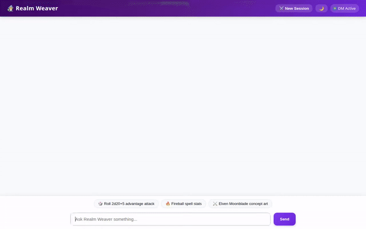

# 🧙‍♂️ Realm Weaver — Master Dungeon Master Agent



**Realm Weaver** is an AI-powered Master Dungeon Master agent designed for tabletop RPG adventures. Built with Google's **Agent Development Kit (ADK)** and deployed on **Vertex AI Agent Engine (Reasoning Engine)**, Realm Weaver handles campaign narration, dice rolling, spell lookups, monster bestiary management, memory persistence for player profiles & dietary allergies, and AI visual concept art & video generation.

---

## 🌟 Implemented Features & Integrations

Realm Weaver integrates the following Google Cloud services, AI models, and custom tools:

### 🔮 AI & Multimodal Generation
* **Vertex AI / Gemini Models**:
  * Root DM reasoning model powered by `gemini-flash-latest`.
  * **Item Image Concept Art**: Custom tool `generate_item_image` powered by `gemini-3.1-flash-lite-image` in the `global` region.
  * **Item Animated Video**: Custom tool `generate_item_video` powered by `gemini-omni-flash-preview` in the `global` region.

### 🧠 Persistent Memory & Profile Management
* **Vertex AI Memory Bank**: Integrates `VertexAiMemoryBankService`, `PreloadMemoryTool`, `LoadMemoryTool`, and `VertexAiLoadProfilesTool` to load and persist player preferences, campaign state, and player dietary/allergy safety profiles across turns and sessions.

### 📜 Database & Cloud Storage
* **Google Cloud Firestore**: Persists tabletop RPG monster bestiary entries with attributes (CR, HP, AC, abilities) via `list_monsters`, `get_monster`, and `add_monster`.
* **Google Cloud Storage (GCS)**: Stores generated RPG item artwork and video clips, providing public HTTPS asset URLs for client rendering.

### 🎨 A2UI Protocol (v0.8) & Rich UI
* **A2UI Schema Manager**: Uses `A2uiSchemaManager(version="0.8")` with `BasicCatalog` and an `after_model_callback` (`a2ui_callback`) to format agent output into structured UI cards (Card, Column, Row, Text, Image).

### 🛠️ Tabletop RPG Tools & Execution
* **Dice Rolling & Math**: `roll_dice` tool for rolling standard D&D dice (`d20`, `2d6+4`, etc.) and `AgentEngineSandboxCodeExecutor` for executing Python code simulations.
* **D&D 5e Spell Rules**: `lookup_dnd_spell` tool querying official 5e spell statistics.
* **Google Maps Platform Integration**: `geocode_address` and `find_nearby_places` tools to translate real-world locations into campaign settings.

### 💻 Web Frontend Application
* **FastAPI A2A Proxy**: A lightweight FastAPI server communicating over Google Agent-to-Agent (A2A) protocols with the deployed Reasoning Engine.
* **Interactive UI**: Includes Tavern Dark/Light mode toggle, Markdown formatting, image lightbox modal, animated thinking indicator, and campaign session reset.

---

## 🚀 Local Setup & Development Instructions

### Prerequisites
* Python 3.10+
* Google Cloud SDK (`gcloud`) authenticated to a GCP project with Vertex AI, Firestore, and GCS enabled.

### 1. Install Dependencies
```bash
# Install root agent dependencies
pip install -r requirements.txt

# Install frontend dependencies
cd frontend
pip install -r requirements.txt
cd ..
```

### 2. Set Environment Variables
Create or edit a `.env` file in the project root:
```bash
GOOGLE_CLOUD_PROJECT="your-gcp-project-id"
GOOGLE_MAPS_API_KEY="YOUR_KEY_HERE"
```

### 3. Run Locally with ADK Web Playground
To launch the agent with the ADK playground:
```bash
uv run adk web . --port 8080 --reload_agents
```

### 4. Run Custom FastAPI Frontend Locally
To run the custom FastAPI A2A proxy server:
```bash
cd frontend
export AGENT_ENGINE_RESOURCE_NAME="projects/<PROJECT_ID>/locations/<REGION>/reasoningEngines/<ENGINE_ID>"
export AGENT_DIRECTORY="app"
python main.py
```
Open a web browser and navigate to port `8080` on your machine.

---

## 📂 Project Structure

```
.
├── app/
│   ├── agent.py          # Root Agent definition, tools, and Memory Bank setup
│   └── a2ui_utils.py     # A2UI callback and surface update handlers
├── frontend/
│   ├── main.py           # FastAPI proxy server for A2A communication
│   ├── requirements.txt  # Frontend Python dependencies
│   └── static/
│       └── index.html    # Web chat interface with A2UI card renderer
├── agents-cli-manifest.yaml # Agent Platform manifest configuration
├── requirements.txt      # Root Python dependencies
├── realm_weaver_demo.gif # Animated demo recording
└── README.md             # Project documentation
```
